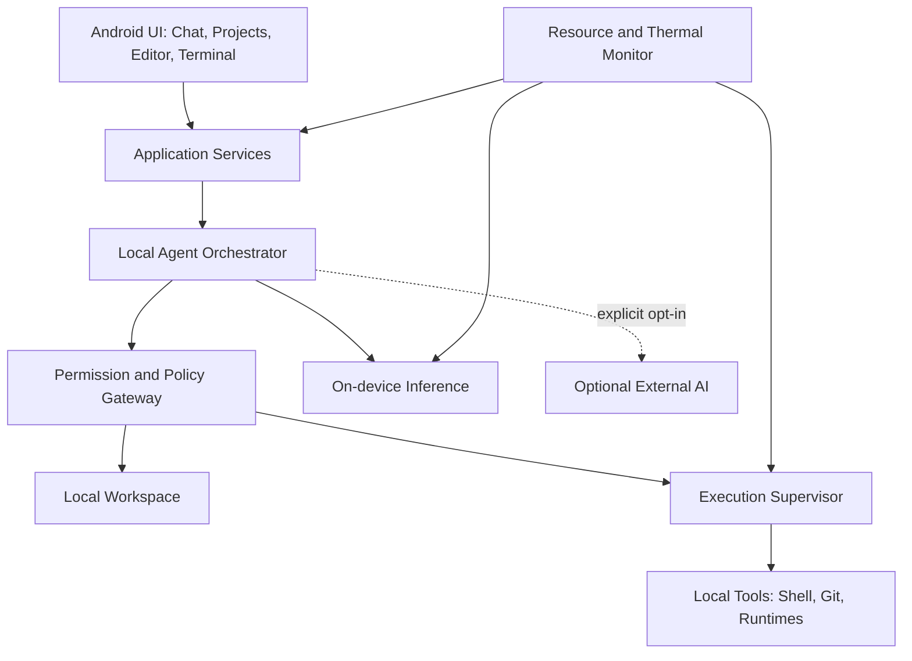

# DOC-04 — System Architecture

## Architecture goal

Separate UI, orchestration, policy enforcement, workspace, execution, and inference so each subsystem can be independently tested.

## Components

- **Android UI:** Compose screens, chat, project browser, editor, terminal, settings.
- **Application services:** lifecycle, persistence, task state, settings.
- **Agent orchestrator:** planning, context management, tool selection and result handling.
- **Policy gateway:** validates paths, commands, permissions, network access, and resource limits.
- **Workspace:** project files, metadata, local database, logs, model assets, backups.
- **Execution supervisor:** process lifecycle, cancellation, timeout, output and concurrency limits.
- **Inference adapters:** local model runtime and separately consented remote providers.
- **Resource monitor:** memory, storage, thermal and task telemetry.

## Trust boundaries

UI-to-service, orchestrator-to-policy, policy-to-filesystem, policy-to-process supervisor, inference-to-model assets, and application-to-network.

## Data flow

The orchestrator proposes actions; policy validates them; filesystem and execution services perform only approved actions. Tool outputs return to the orchestrator and UI. Local-only mode blocks remote provider access at the policy/network layer.

## Proposed technology direction

Native Kotlin Android application with Jetpack Compose. Use Android platform APIs for lifecycle, storage access, secure key handling, and background work. Select database, process runtime, and inference engine only after feasibility tests.

## Architecture decisions pending

Module layout, database technology, runtime isolation, process service model, model engine, minimum Android version, and whether any shared backend is needed.
